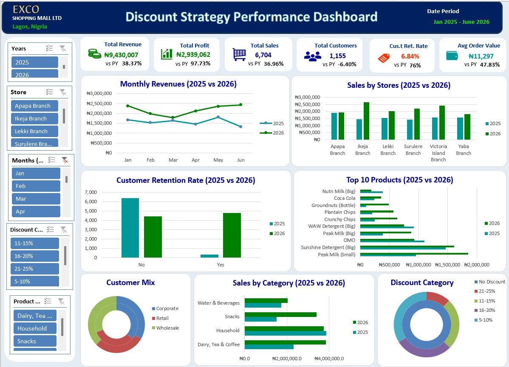
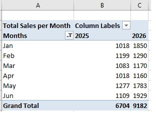
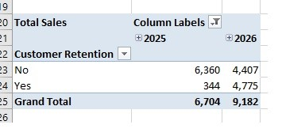
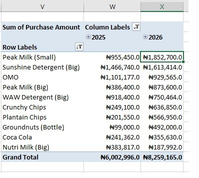
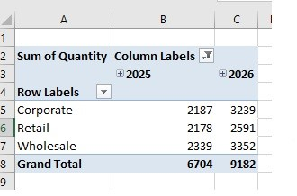
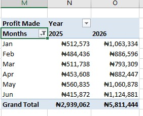

# IMPACT OF DISCOUNT STRATEGY ON SALES PERFORMANCE AND CUSTOMER RETENTION (JANUARY 2025 VS JUNE 2026)

### DESCRIPTION
Impact of Discount Strategies on Sales Performance, Customer Retention, and Profitability: A Case Study of Exco Shopping Mall. This project was carried out extensively with MS Excel and Power Query.

 

## TABLE OF CONTENTS 
- OBJECTIVE
- DATA SOURCE
- STAGES
- DESIGN
    - Mockup
    - Tools
- DEVELOPMENT
    - Pseudocode
    - Data Exploration
    - Data Cleaning
    - Transform the Data
- TESTING
    - Data Quality Tests
- VISUALIZATION
    - Results
- ANALYSIS
    - Findings
    - Validation
    - Discovery
- RECOMMENDATIONS
    - Potential ROI
    - Potential Courses of Actions
- CONCLUSION

 

## OBJECTIVE
<ins>What is the key point?</ins>

The Head of Sales wants to find out how the discount introduced this year (2026) affected sales. And wants to know if the discount has been effective or should be removed.
<ins>To build a dashboard that shows the impact of the discount, it’ll include;</ins>
-	Total sales after vs before
-	Profit before vs after
-	Discount amount
-	Customer type

<ins>USER STORY</ins>

The Head of Sales at Exco Shoppin Mall introduced discount to purchases in January 2026 with the aim of increasing sales and retaining customers without tightening profit much.  Now, he wants to find out;

    - Did introducing discounts increase sales Performance?
    - Did discount improve customer retention?
    - What discount range generated the highest profit?
    - Which product categories benefited the most from discount?

With the sales record available (from Jan 2025 – June 2026), we’re going to use the discount given, sales recorded, profit generated and customer type. And we will compare the record from when the discount was introduced (Jan 2026) till date (June 2026) with previous record (Jan 2025 – Dec 2025).

## DATA SOURCE

What is needed to achieve our objective? This will determine our data source.
Since it is within the company, we will need the company’s Sales Data (Sales Record) that includes:

- discount given to customers
- sales recorded
- profit generated; and
- customer type

The data source is a first party data generated from ChatGPT.

## STAGES
    1.	Design
    2.	Development
    3.	Testing
    4.	Analysis

 

## DESIGN
<ins>Dashboard components</ins>

What should the dashboard contain based on the requirements provided? 
To understand what it should contain, we need to figure out what questions we need the dashboard to answer:
- Did discounts increase sales? 
- Did discounts improve customer retention? 
- Which products benefited most from discounts? 
- Which customer segment responded best? 
- Did profits rise or fall? 
- What discount range produced the best balance between sales and profit?

<ins>Dashboard Mockup</ins>
- Monthly Sales (Line Chart) 
- Stores (Clustered Column)
- Sales by Product/Category (Horizontal bar Chart)
- Top 10 products (Horizontal bar Chart)
- Brand or Category contribution (Doughnut Chart)
- Discount Cat (Pie Chart)
- Customer Retention rate (Column Chart)

<ins>Tools</ins>

Microsoft excel was used to;
- Explore the data
- Clean, test and analyze the data
- Visualize the data via interactive dashboards

GitHub was used to host the project.

 

## DEVELOPMENT
<ins>Pseudocode</ins>
1.	Get the data
2.	Explore the data in Excel
3.	Clean the data with Excel
4.	Test the data with Excel
5.	Visualize the data
6.	Generate the findings based on the insights
7.	Write the documentation + commentary
8.	Publish the data to GitHub Pages

<ins>Data Exploration notes</ins>
- It contained 3,618 rows with 29 columns.
- The customer ID matches each customer’s name so it won’t be needed and will be removed.
- The city column is not necessary since the store names are already here, likewise the payment and year column.
- Each store has only one salesperson per store.
- A new column,” Net Profit”, will be inserted to show the net profit, which is the deduction of discount amount from the profit.
- Another column (Year Half) was inserted to show what each half of the year had to show since the year we’ll be looking into is the first half of this year. We have to compare it with last year’s first half to avoid getting a wrong analysis.
- We tried to understand the “Purchase Type”, “Days since last purchase” and “Customer Retention” column as it’ll play a key role in finding how discount affected the retention of customers.

 

<ins>Data Cleaning</ins>
1.	Unnecessary columns were removed. 
    - Customer name - since we will be using the customer ID for our analysis.
    - Payment method – it holds no value or importance to our analysis.
    - Age group – we don’t necessarily need it for anything in our analysis.
    - City – we already have the store name.
    - Year, Quarter & Month – as the whole detail is already in the date given for each transaction.
2.	Blanks were identified in the following columns:
    - Unit price – we used INDEX MATCH to find the unit price of each product with a missing value and fill it in.
    - Day since last purchase – was intentionally left blank for new customers since a new customer can’t have any detail here since such a person has never been to the store.
3.	30 duplicates were found with all the columns containing exact figures.
4.	There were much errors in the dataset arising from the compilation of the profit, and the discount amount. Calculations were put in place to resolve these errors.
5.	We used Power Query to rearrange and restructure the columns for easy Calculation. This made it easy to for us to appreciate the data and wrangle it properly. After we made all possible adjustments, we loaded it back into our workbook.
6.	The following columns were added or modified;
    - Cost – was changed to “Cost Price” to show the actual details in the column.
    - Sales Amount - was changed to “Purchase amount” to signal that the details in the column were purchases made and to aid in calculations.
7.	Formatting 
    - Date – Order date (custom date for Nigeria was used)
    - Number – Quantity & Satisfaction score
    - Currency (Nigerian) – Cost price, Unit Price, Purchase amount, Profit and Discount amount. All were approximated to 1 decimal place.
    - Percentage – Discount (%)
    - General – other columns
8.	We used helper column to evaluate the discount column as its format and order was impairing the calculations needed to get the exact discount amount that was implemented.
9.	The whole data was filtered to show only results from Jan-Jun 2025 and Jan-Jun 2026; as this would be best for our data as we are taking the analysis half of the year.

<ins>Data Testing</ins>

We checked for Data validity to be sure each row and column meets the required data each should have.

 

## VISUALIZATION
### Results

<ins>Dashboard</ins>

 

## ANALYSIS
### Findings

Before we begin, we had some questions we set out to find the answers in this project.
What are they:

    - Did discounts increase sales?
    - Did discounts improve customer retention?
    - Which products benefited most from discounts?
    - Which customer segment responded best?
    - Did profits rise or fall?
    - Which branch generated the highest revenue?
    - What discount range produced the best balance between sales and profit?

<ins>1.	DID DISCOUNT INCREASE SALES</ins>

 

<ins>2.	DID DISCOUNTS IMPROVE CUSTOMER RETENTION? </ins>

 

<ins>3.	WHICH PRODUCTS BENEFITED MOST FROM DISCOUNTS?</ins>

 

<ins>4.	WHICH CUSTOMER SEGMENT RESPONDED BEST?</ins>

 

<ins>5.	DID PROFITS RISE OR FALL?</ins>

 

<ins>6.	WHAT DISCOUNT RANGE PRODUCED THE BEST BALANCE BETWEEN SALES AND PROFIT?</ins>

| DISCOUNT CATEGORY | TOTAL SALES     | TOTAL PROFIT  | SALES-PROFIT RATIO (%) |
| ----------------- | --------------- | ------------- | ---------------------- |
| 5-10%             | ₦5,116,004.0    | ₦1,971,562.2  | 38.53%                 |
| 11-15%            | ₦3,331,166.0    | ₦1,473,669.1  | 44.24%                 | 
| 16-20%            | ₦3,344,617.0    | ₦1,666,185.2  | 49.82%                 | 
| 21-25%            | ₦1,256,114.0    | ₦700,027.5    | 55.73%                 |

 

### VALIDATION
<ins>Did discounts increase sales?</ins>

        Sales in 2025 (Jan – Jun) = ₦9,430,007
        Sales in 2026 (Jan – Jun) = ₦13,047,901
        Sales Performance = (2026 Sales – 2025 Sales)/2025 Sales
        Sales Performance Ratio = (₦13,047,901 - ₦9,430,007)/₦9,430,007 = 0.3836576
        Percentage increase = (₦13,047,901 - ₦9,430,007)/₦9,430,007 = 0.3836576 x 100 = 38.37%
        Sales Performance was increased by 38.37% in 2026.

<ins>Did discounts improve customer retention?</ins>

        Customers Retained in 2025 (Total Customers) = 344 (6,704)
        Customers Retained in 2026 (Total Customers) = 4775 (9,182)
        Customers Retention Rate in Year (N) = (Customer Retained/Total No. of Customers) x 100
        Customers Retention Rate in 2025 = (344/6,704) x 100 = 5.13%
        Customers Retention Rate in 2026 = (4775/9,182) x 100 = 52.00%
        Customer Retention Rate in 2026 was incredibly higher with 52%, as opposed to 5.13% in 2025.
        
<ins>Which discount range generated the highest profit?</ins>
(use table diagram)

        Discount Category;
        5-10% = ₦1,971,562.2
        11-15% = ₦1,473,669.1
        16-20% = ₦1,666,185.2
        21-25% = ₦700,027.5
        
As we see, giving a little discount of about 5-10% produced the highest profit.

<ins>Which discount range produced the best balance between sales and profit?</ins>

(use table diagram)

| DISCOUNT CATEGORY | TOTAL SALES     | TOTAL PROFIT  | SALES-PROFIT RATIO (%) |
| ----------------- | --------------- | ------------- | ---------------------- |
| 5-10%             | ₦5,116,004.0    | ₦1,971,562.2  | 38.53%                 |
| 11-15%            | ₦3,331,166.0    | ₦1,473,669.1  | 44.24%                 | 
| 16-20%            | ₦3,344,617.0    | ₦1,666,185.2  | 49.82%                 | 
| 21-25%            | ₦1,256,114.0    | ₦700,027.5    | 55.73%                 |

We can see that much despite the discount range of 5-10% having more sales (₦5,116,004.0), the discount range of 21-25% has more balance between sales and profit with the profit amounting to 55.73% of the whole sales amount.

 

## DISCOVERY
1.	Sales in 2026 (Jan-Jun) showed a 38.37% improvement, amounting to ₦13,047,901.
2.	In the first half of 2025, only 344 customers were retained as opposed to the 4775 customers who were retained in the first half of 2026. With 2026 showing a 52% increase in the Customer Retention Rate, as opposed to the 5.13%.
3.	The discount range between 5-10% generated the highest amount of profit (₦1,971,562.2), while the ranges between 21-25% showed the least amount of profit (₦700,027.5).
4.	From the data we have, we got the table which shows that despite the 5-10% discount range having the highest profit (₦1,971,562.2), it did not produce the best balance with sales as its profit ratio is 3.85(38.5% of sales). But the discount range of 16-20% with the least profit (₦1,666,185.2), which is 4.98 (49.82% of the total sales).

## RECOMMENDATION
- From what we’ve seen, the discount needs to be continued in order to boost sales and retain customers.
- Also, most discounts from now on should fall between 16-20% as it produced the best balance between sales and profit.

 

